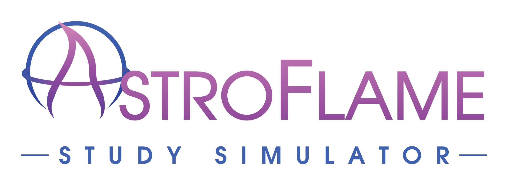

# AstroFlame


[AstroFlame](https://astroflame.study) is a NASA Space Apps 2026 project for
exploring microgravity flame spread over PMMA fuel surfaces. The site includes
an interactive simulator, a measured-versus-predicted BASS comparison, and
read-only JSON data endpoints.

The project uses **SAFFIRE-V** data for its ribbed-PMMA comparison because that
dataset provides a more comprehensive experimental set for rib-width-dependent
flame spread. This project name refers to the NASA
[SAFFIRE-V project](https://techport.nasa.gov/projects/13543).

## What the site does

- **Simulator:** runs a bounded flame-spread model in the visitor's browser.
  The model is written in TypeScript and does not need a database to run.
- **Analysis:** compares 39 curated BASS-II measurements from 18 experiments
  with predictions from the simulator's regression form. It groups residuals
  (measured minus predicted) by airflow, sample thickness, or initial oxygen.
  Predictions are evaluated using grouped leave-one-experiment-out
  cross-validation: all observations from one experiment are withheld while
  the model is fit, then used for comparison.
- **Data API:** serves selected BASS experiment records and the BASS analysis
  results as JSON. The browser asks the app for this data; it never connects
  directly to the database.

## Project goal and intended audience

AstroFlame is an **evidence-bounded learning and research-exploration tool**.
Its goal is to make microgravity flame-spread measurements easier to explore,
show how a simple model responds to inputs, and make the model's evidence
limits visible.

The primary audience is undergraduate and graduate students, teachers, and
professors studying combustion, data science, or space science. Researchers
can also use it to explore hypotheses and compare model output with the
curated data. It is not a certified engineering tool: mission planners should
not use its results to choose materials, change ventilation, or make
operational fire-safety decisions.

Useful learning activities include comparing modeled rates with the measured
BASS records, seeing how results change within the tested input ranges, and
using an unexpected result to propose another controlled experiment. These
activities support research and teaching; they do not produce spacecraft
design or operational safety recommendations.

## Where the data comes from

The comparison data is the curated project file
[`elig-data/astroflame_formatted_cgs.csv`](elig-data/astroflame_formatted_cgs.csv).
It contains 39 BASS-II PSI-25 observations and 18 digitized SAFFIRE-V
observations. The importer keeps source labels, experiment and
observation IDs, measurement notes, and provenance fields alongside the
values. NASA's [TechPort page](https://techport.nasa.gov/projects/13543)
provides SAFFIRE-V project context; it is not itself a direct measurement-file
download endpoint.

The simulator's input bounds and model data are in the TypeScript source and
the repository's curated data. The simulator does **not** query TigerData.
The Analysis page does query TigerData for the curated BASS observations, then
fits and evaluates the grouped model on the server.

The repository also has a separate importer for BASS experiment records from
NASA PSI-26. It is exposed through the experiments API. Old PSI-100 telemetry
is not part of the active importer, database schema, API, or public UI. Old
archived research files remain historical records and are not changed or
relabeled.

## How the parts fit together

Think of the system as two data paths:

```text
Simulation:
Visitor's browser -> TypeScript model -> flame map, timer, and growth chart

Stored-data analysis:
Curated CSV -> local Node.js import script -> TigerData PostgreSQL
Visitor's browser -> Cloudflare Worker API -> Hyperdrive -> TigerData
```

- **Cloudflare Workers** runs the website and API.
- **Hyperdrive** is Cloudflare's managed connection from the Worker to the
  database. It keeps database credentials out of browser code.
- **TigerData** stores the curated measurements and imported PSI-26 BASS rows.
  In this project it is used as PostgreSQL storage; the spread-rate
  observations are fixed experiment records, not time-series telemetry.
- **React and TypeScript** make the interface and run the simulator.
- **Vite and vinext** run and build the app. The folders use Next.js App
  Router conventions, but this repository does not run the standard Next.js
  CLI.
- **Node.js scripts** validate and import the CSV data. SQL in
  `astroflame/db/schema.sql` describes the database tables.
- **Python** is not used by the active app, simulator, analysis, or database
  import path. An optional older NASA file downloader is kept under
  `archive/misc/`.

## Model scope and cautions

The BASS controls are bounded to the available experimental ranges: airflow
2–21 cm/s, oxygen 17.9–22.2%, and fuel thickness 0.1–0.5 cm. The simulated
surface is based on the BASS sample geometry. SAFFIRE-V airflow is restricted
to the measured 5 or 20 cm/s settings; the rib-width spread-rate values are
interpolated only within the digitized values available for the selected
airflow.

The opposed-flow rate points against the incoming airflow. The model also
shows lateral and concurrent directions using the simulator's directional
spread assumptions. Those assumptions and the concurrent multiplier are
exploration controls, not additional measurements for every scenario.

Predictions near or outside the measured ranges are uncertain. The model is
for scientific exploration and is **not** a fire-safety or operational
prediction tool. It does not estimate ignition probability, burn duration, or
a limiting oxygen concentration.

## Gemini learning notes

When a simulation finishes, the browser sends a small summary of its scenario,
settings, ignition location, and completed results to the server route
`POST /api/simulation/insights`. The route checks the scenario inputs against
the simulator's bounds, adds the relevant evidence notes, and calls the
Gemini API using the `gemini-3.8-flash` model. Gemini returns a short summary,
observations, a possible non-operational research application, a research
question, and limitations; the interface checks the response shape before
displaying it in the **AI learning notes** dashboard card.

The simulator calculates all numbers. Gemini only writes explanatory text;
it cannot change the run, its equations, or its results. The notes are
educational and can be wrong, so they are labeled AI-generated and are not
safety or mission-operational advice. A missing key, network error, or Gemini
failure does not stop or erase a simulation. The notes are not saved to
TigerData. The simulation summary is sent to Google's Gemini API, so users
should not include private or sensitive information in scenario data.

The integration uses the Gemini REST API from server-side code and adds no
Google SDK dependency. The API key is read only by the server Worker, never
sent to browser code. Before making this public, restrict the Google key to the
Gemini API, set an appropriate usage quota, and configure Cloudflare rate
limiting for `/api/simulation/insights`; this endpoint can use your Gemini
quota.

## Beginner setup: run the site locally

### You will need

- Node.js 22.23+, 24.22+, or 26.12+, plus npm, for the current Cloudflare
  command-line tooling.
- A Cloudflare account to authenticate the local Worker runtime.
- The repository's environment settings. The simulator code itself does not
  need TigerData, but the development configuration requires a Hyperdrive ID.
- A TigerData service only if you want to run the database-backed Analysis/API
  locally or import data.

### 1. Install the project

Open PowerShell or a terminal, then run:

```powershell
git clone https://github.com/peiyuxs/nasaspaceapps26.git
Set-Location nasaspaceapps26\astroflame
npm ci
```

`npm ci` installs the exact package versions recorded by the project.

### 2. Create the local settings file

```powershell
Copy-Item .env.example .env
```

Open `astroflame/.env` and set:

```dotenv
CLOUDFLARE_HYPERDRIVE_ID=your-cloudflare-hyperdrive-id
TIGER_DATABASE_URL=your-private-tigerdata-postgresql-connection-string
```

Never commit or share `.env`; the database URL contains a password. For local
simulation-only work, the database does not need to be populated, but
`cloudflare.config.ts` still requires a Hyperdrive configuration ID.

### 3. (Optional) Set up Gemini learning notes

If you want the AI note after each run:

1. Create a Gemini API key in
   [Google AI Studio](https://aistudio.google.com/apikey). Review the
   [Gemini API key guidance](https://ai.google.dev/gemini-api/docs/api-key)
   and your account's usage limits.
2. From `astroflame/`, make the local secret file:

   ```powershell
   Copy-Item .dev.vars.example .dev.vars
   ```

3. Open `.dev.vars` and replace the example value:

   ```dotenv
   GEMINI_API_KEY=your-private-gemini-api-key
   ```

   `.dev.vars` is ignored by Git. Never commit it, paste it into browser code,
   or share it. The example file contains only a placeholder.

If no key is set, the simulator still works and the notes card explains that
Gemini is not configured.

### 4. Authenticate and start the website

```powershell
npx cf auth login
npm run dev
```

Open the local URL printed by the command (usually
`http://localhost:5173`). Stop the server with `Ctrl+C`.

To try Gemini, choose a scenario, click **Run**, and wait for the simulation
to finish. The AI learning notes card should first show a loading state, then
the summary, observations, possible research application, and research
question. To check the feature code without making a Google API request, run
`npm run test:insights`.

## Beginner setup: TigerData and database data

TigerData provides a managed PostgreSQL database. The steps below create its
tables and load the repository's curated measurement rows.

### 1. Create a TigerData database

1. Sign in to the [TigerData console](https://console.cloud.timescale.com/).
2. Create a PostgreSQL service, or select a service you control.
3. Copy its direct PostgreSQL connection string from the connection details.
4. Put that connection string in `TIGER_DATABASE_URL` in `astroflame/.env`.
   Keep it private.

### 2. Create the tables

From `astroflame/`, run:

```powershell
npm run db:migrate
```

This sends the SQL in `db/schema.sql` to the database. The schema contains:

- `spread_rate_observations`: curated BASS and SAFFIRE-V spread-rate
  measurements used by the Analysis API.
- `investigations`, `source_files`, and `bass_experiments`: source metadata
  and BASS rows for the PSI-26 experiments endpoint.

The migration creates missing tables and converts any stored legacy
SAFFIRE regime labels to the current `SAFFIRE-V` label. It does not import
data or delete historical database tables.

### 3. Preview and import the Analysis data

First preview locally. This reads the CSV, checks required fields, calculates
the grouped BASS validation, and does **not** connect to or change TigerData:

```powershell
npm run analysis:preview
```

Then, when you intend to write the curated rows to the database:

```powershell
npm run analysis:import
```

The importer replaces the rows previously loaded from this same curated source
file in `spread_rate_observations`, inside a database transaction. It loads
BASS and SAFFIRE-V records; only the BASS rows are used for the current
measured-versus-predicted Analysis view.

### 4. Check that the TigerData connection and data work

These are end-to-end checks for your own local setup. They require your local
`.env`, a TigerData service, the tables, and the imported analysis data.

1. Start the website from `astroflame/`:

   ```powershell
   npm run dev
   ```

2. In a second PowerShell window, ask the app if it can reach the database:

   ```powershell
   Invoke-RestMethod http://localhost:5173/api/health/db
   ```

   A working connection replies with `status: ok` and `database: connected`.
3. Ask the Analysis API for the stored BASS comparison:

   ```powershell
   $result = Invoke-RestMethod http://localhost:5173/api/analysis/bass
   $result.metrics
   $result.records.Count
   $result.groups
   ```

   You should see 39 records, metrics, and grouped residual summaries. Try
   `http://localhost:5173/api/analysis/bass?groupBy=thicknessCm` to group by
   thickness instead of airflow.
4. Open `http://localhost:5173/`, scroll to **Analysis**, and change
   **Group residuals by**. The scatter plot and table should load from the
   same API.

If the health check fails, check the TigerData URL, network access, and local
Hyperdrive settings. If health works but the analysis endpoint says no BASS
data is loaded, run `npm run analysis:preview` first; if that succeeds, run
`npm run analysis:import` to load it. The preview is safe and read-only; the
import command writes to your database.

`npm run test:analysis` tests the data validation and model logic without
connecting to TigerData. Passing those tests alone does not confirm that your
database credentials or Cloudflare connection work.

### 5. (Optional) Import PSI-26 BASS experiment records

This is a separate NASA PSI download and database import from the curated
Analysis data:

```powershell
npm run data:preview
npm run data:import
```

Preview validates the selected public PSI-26 CSV without a database write.
The import command writes its source metadata and BASS experiment rows to
TigerData.

## Beginner setup: connect Cloudflare to TigerData

Cloudflare Workers runs the deployed site. A Worker cannot safely use a
database password embedded in browser JavaScript. Hyperdrive is the
Cloudflare-managed bridge that lets Worker API code connect to TigerData.

1. In the [Cloudflare dashboard](https://dash.cloudflare.com/), open
   **Workers & Pages → Hyperdrive**.
2. Create a Hyperdrive configuration for the same TigerData PostgreSQL
   service. Enter the host, port, database, username, and password from
   TigerData; keep SSL enabled.
3. Copy the Hyperdrive configuration ID to `CLOUDFLARE_HYPERDRIVE_ID` in
   `astroflame/.env`.
4. Authenticate the CLI if needed:

   ```powershell
   npx cf auth login
   ```

5. To build locally, run `npm run build`. To publish a Worker, run
   `npm run deploy` from `astroflame/`.

The deployed Worker uses the Cloudflare Hyperdrive binding. The local database
scripts use `TIGER_DATABASE_URL` directly. Do not deploy or import data unless
you intend to make those changes to your own Cloudflare account/database.

## Add the Gemini key to a deployed Worker

Local `.dev.vars` only applies to your local development server. To enable
Gemini on a deployed Worker:

1. Open Cloudflare **Workers & Pages**, choose the `astroflame` Worker, and
   open **Settings → Variables and Secrets**.
2. Add a secret named `GEMINI_API_KEY` and paste the key value into Cloudflare's
   secret field. Do not add it as a public `NEXT_PUBLIC_*` or `VITE_*` setting.
   See Cloudflare's
   [Worker secrets guide](https://developers.cloudflare.com/workers/configuration/secrets/).
3. Use your normal, separately approved deployment process for the Worker.
   This README does not deploy the site.
4. Check the worker logs and API quota if the notes show an error.

The API key is a billable/quota-controlled credential. Keep it restricted to
Gemini API access and set usage limits in Google AI Studio/Google Cloud.
Because the notes endpoint is public, apply a Cloudflare rate-limit rule to
`POST /api/simulation/insights` before enabling it for public traffic.

## API endpoints

The app's API routes return JSON. A beginner-friendly way to think about an
endpoint is: it is a URL that accepts a request and replies with structured
data rather than a full web page.

| Endpoint | What it returns |
| --- | --- |
| `GET /api/health/db` | Whether the Worker can reach the database |
| `GET /api/investigations` | PSI-26 investigation metadata |
| `GET /api/investigations/PSI-26/experiments?limit=100` | Up to 100 imported PSI-26 BASS experiment records |
| `GET /api/analysis/bass` | BASS measurements, grouped held-out predictions, and error metrics for the chart |
| `GET /api/analysis/bass?groupBy=thicknessCm` | Same analysis, with residual summaries grouped by thickness |
| `GET /api/analysis/bass?groupBy=oxygenInitialPct` | Same analysis, grouped by initial oxygen |
| `POST /api/simulation/insights` | Validates one completed simulation summary and returns Gemini learning notes |

`groupBy` accepts `airflowCmS`, `thicknessCm`, or `oxygenInitialPct`. The API
returns an error if its database connection or required data is unavailable.
The Analysis view needs the spread-rate migration and the curated import; it
does not use the PSI-26 importer.

## Next.js-style pages and routes

This codebase uses a Next.js-like folder layout through vinext:

- `astroflame/app/page.tsx` is the home page.
- `astroflame/app/documentation/page.tsx` serves `/documentation`.
- A folder such as `astroflame/app/api/example/route.ts` defines API handlers
  for `/api/example`.

The project commands are based on Vite and vinext, not `next dev` or
`next build`:

```powershell
npm run dev
npm run build
```

Shared navigation and page metadata are in `astroflame/app/layout.tsx`.

## Playwright browser testing

Playwright is **not currently installed or configured** in this repository.
Existing automated tests use Node's test runner. If you want browser
automation later, add it from `astroflame/`:

```powershell
npm install --save-dev @playwright/test
npx playwright install
```

Then create `playwright.config.ts`, add browser tests, and configure its
`webServer` to start `npm run dev`. Add a script such as
`"test:e2e": "playwright test"` to `package.json`, then run:

```powershell
npm run test:e2e
```

Tests that exercise database-backed pages need a reachable TigerData service,
the schema, and imported rows. Do not put database credentials in test code.

## Python and the database/model logic

The currently used model, simulator, Analysis calculation, and database
importers are **not Python**:

- `astroflame/lib/` contains the TypeScript model, simulation, and grouped
  validation logic.
- `astroflame/scripts/` contains Node.js scripts that parse and validate CSV
  files, then use PostgreSQL to import rows.
- `astroflame/db/schema.sql` defines the tables and indexes.
- `astroflame/app/api/` contains server-side JSON endpoints. The Analysis
  endpoint reads BASS observations from TigerData and calculates predictions
  and residuals.

An older optional Python downloader is in `archive/misc/`; it downloads files
from NASA PSI and is separate from the active app and TigerData pipeline. To
use it, install Python 3 and run from the repository root:

```powershell
Set-Location archive\misc
py -m venv .venv
.\.venv\Scripts\Activate.ps1
python -m pip install -r requirements.txt
python downloadfiles.py --list-only
python -m unittest -v test_downloadfiles.py
```

This utility does not populate the AstroFlame database. Its optional Cloudflare
R2 upload requires separate credentials; never commit them.

## Useful commands

Run these from `astroflame/`:

| Command | Purpose |
| --- | --- |
| `npm run dev` | Start the local site |
| `npm run build` | Build the Cloudflare Worker app |
| `npm run start` | Preview a built app |
| `npm run deploy` | Deploy to Cloudflare |
| `npm run db:migrate` | Create database tables and indexes |
| `npm run analysis:preview` | Validate curated comparison data without DB writes |
| `npm run analysis:import` | Load curated BASS and SAFFIRE-V comparison rows |
| `npm run data:preview` | Validate the PSI-26 NASA CSV without DB writes |
| `npm run data:import` | Import PSI-26 BASS experiment records |
| `npm run test:analysis` | Test grouped BASS validation and curated data loading |
| `npm run test:insights` | Test simulation-summary validation and Gemini response parsing, without calling Gemini |
| `npm run test:model` | Test the simulator model and flame simulation |
| `npm run test:import` | Test the PSI-26 importer |
| `npx tsc --noEmit` | Check TypeScript types |

## Project layout

```text
nasaspaceapps26/
├── README.md
├── elig-data/
│   └── astroflame_formatted_cgs.csv  # Curated BASS and SAFFIRE-V measurements
└── astroflame/
    ├── app/
    │   ├── api/                      # Health, BASS analysis, and PSI-26 JSON APIs
    │   ├── components/               # Simulator and comparison UI
    │   ├── documentation/            # Documentation page
    │   ├── globals.css
    │   ├── layout.tsx                # Shared navigation and metadata
    │   └── page.tsx                  # Home page
    ├── db/schema.sql                 # PostgreSQL tables and indexes
    ├── lib/                          # TypeScript model and validation logic
    ├── scripts/                      # Data import and migration scripts
    ├── cloudflare.config.ts          # Cloudflare Worker and Hyperdrive binding
    ├── vite.config.ts                # Vite/vinext app configuration
    └── package.json                  # Dependencies and commands
```

## References

- NASA Physical Sciences Informatics. [PSI-26: Burning and Suppression of Solids (BASS)](https://psi.nasa.gov/physci/repo/data/investigations/PSI-26).
- NASA TechPort. [SAFFIRE-V: Spacecraft Fire Safety Demonstration (Saffire)](https://techport.nasa.gov/projects/13543).
- Olson & Ferkul. [NASA Glenn Research Center BASS-II / POIWG](https://ntrs.nasa.gov/api/citations/20140011099/downloads/20140011099.pdf).
- [Microgravity Flame Spread in Exploration Atmospheres: Pressure, Oxygen, and Velocity Effects on Opposed and Concurrent Flame Spread](https://www.researchgate.net/publication/255013038_Microgravity_Flame_Spread_in_Exploration_Atmospheres_Pressure_Oxygen_and_Velocity_Effects_on_Opposed_and_Concurrent_Flame_Spread).
